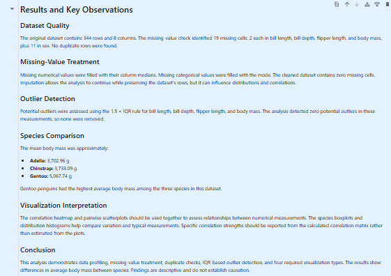
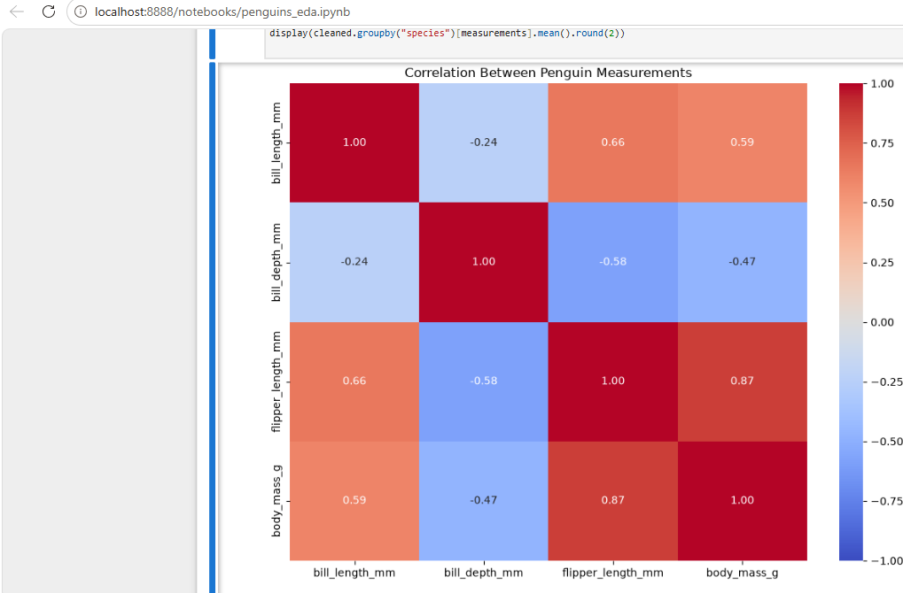

# CodeNova Task 1 — Exploratory Data Analysis

## Project Overview
This project performs Exploratory Data Analysis (EDA) on the Palmer Penguins dataset. It examines data quality, handles missing values, checks duplicates, detects potential outliers, and explores relationships between penguin measurements.

## Dataset
The dataset contains 344 rows and 8 columns, including:
- Species and island
- Bill length and bill depth (mm)
- Flipper length (mm)
- Body mass (g)
- Sex and year

The dataset includes naturally occurring missing values.
## Dataset Source and Attribution

- **Dataset:** Palmer Penguins
- **Authors:** Allison Horst, Alison Hill, and Kristen Gorman
- **Source:** https://allisonhorst.github.io/palmerpenguins/
- **Repository:** https://github.com/allisonhorst/palmerpenguins

Refer to the original repository for applicable dataset license and usage terms.


## Analysis Performed
1. Dataset profiling: shape, data types, summary statistics, and missing-value counts.
2. Data cleaning: duplicate removal and missing-value imputation.
3. Outlier detection using the 1.5 × IQR rule.
4. Correlation heatmap for numerical measurements.
5. Feature distribution plots.
6. Boxplots comparing measurements by species.
7. Pairwise scatterplots of numerical measurements.
8. Mean measurement summaries by species.

## Missing-Value Handling
The original dataset contained 19 missing cells. Numerical columns with missing values were filled using their respective medians. Missing categorical values were filled using the most frequent category (mode). After cleaning, no missing cells remained.

The original dataset is preserved. The cleaned dataset is saved separately as `outputs/penguins_cleaned.csv`.

## Outlier Detection
Potential outliers were checked using the Interquartile Range (IQR) method. Values below Q1 − 1.5 × IQR or above Q3 + 1.5 × IQR were flagged. No potential outliers were detected in the four numerical measurements examined. No outliers were removed.

## Key Findings

- Gentoo penguins had the highest mean body mass (5,067.74 g) and mean flipper length (217.02 mm).
- Chinstrap penguins had the highest mean bill length (48.83 mm), while Adelie penguins had the lowest (38.83 mm).
- Flipper length and body mass showed a strong positive correlation (r = 0.871).
- Bill length showed moderate positive correlations with flipper length (r = 0.656) and body mass (r = 0.595).
- Bill depth showed negative correlations with flipper length (r = -0.584) and body mass (r = -0.472).
- These findings are descriptive and do not establish causal relationships.

## Project Structure
- `data/penguins.csv` — original dataset
- `src/penguins_eda.py` — analysis script
- `outputs/penguins_cleaned.csv` — cleaned dataset
- `outputs/penguins_missing_values.csv` — missing-value report
- `outputs/penguins_outlier_report.csv` — outlier report
- `outputs/penguins_species_summary.csv` — species mean measurements
- `outputs/figures/` — generated visualizations

## How to Run
From the project root, run:

```bash
python src/penguins_eda.py
```

Required Python packages: pandas, matplotlib, and seaborn.

## Conclusion
The analysis demonstrates dataset profiling, missing-value handling, duplicate checks, outlier detection, and visualization of penguin measurements. Visual findings should be interpreted in the context of the dataset and its limitations.

## Project Visualizations

### 1. Correlation Heatmap


### 2. Feature Distributions


### 3. Boxplots by Species


### 4. Pairwise Scatterplots


## Notebook Execution Screenshots



